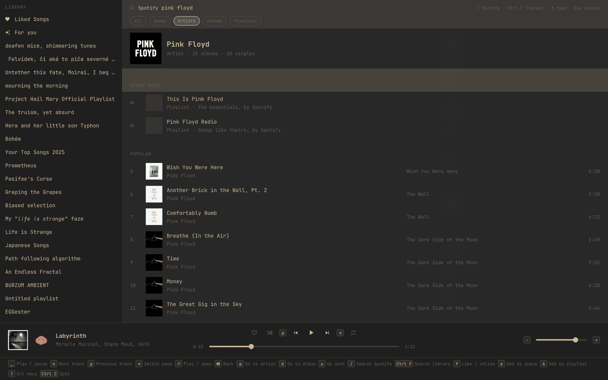
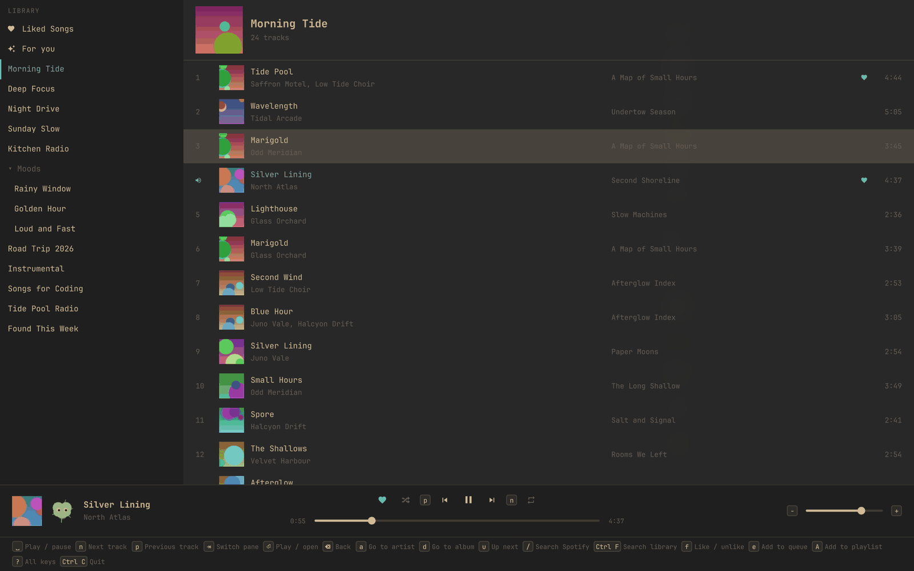
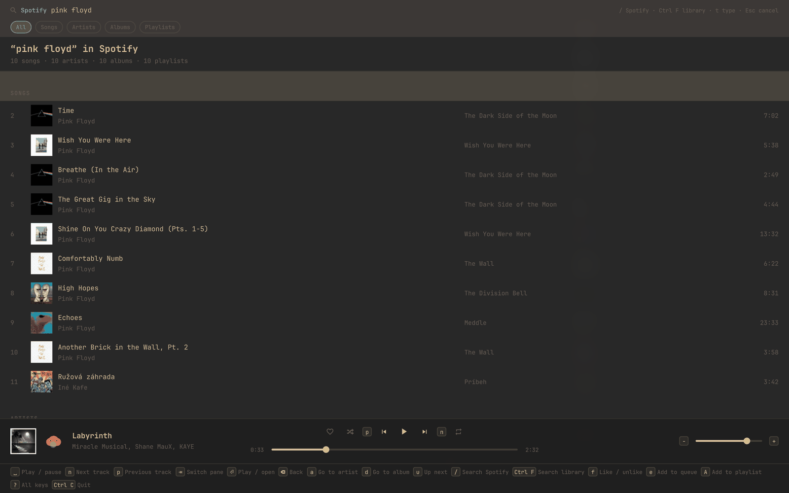
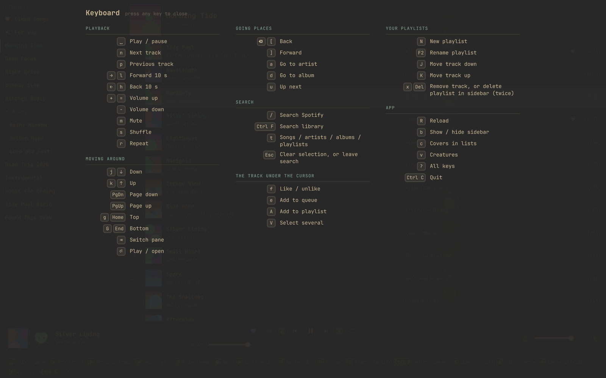
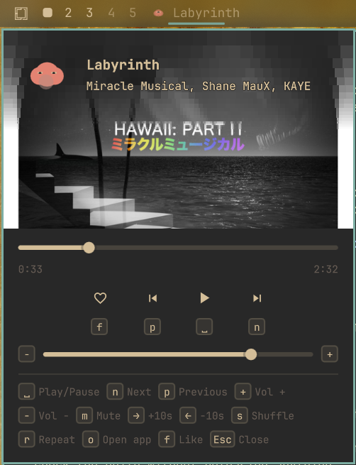

# Sporetify

A fast, keyboard-first Spotify client for [Omarchy](https://omarchy.org/):
transport and volume in the bar, a mini-player under it, and a full app
window for your library.

**Before you install, know that Sporetify is unofficial.** It is not made or
endorsed by Spotify. It signs in the way Spotify's own desktop app does and
talks to the same internal services, which are undocumented and may change
or be closed at any time, and using them may be against Spotify's terms of
service. Use it at your own risk.

What it does: playback, your playlists and folders, Liked Songs, the
playlists Spotify makes for you, artist and album pages with artist radio,
search across all of Spotify and across your library, likes, add to queue,
playlist editing, cover art, and a library that still opens when you are
offline.

<p align="center">
  
</p>

<p align="center">
  
  
  <br>
  <sub>Your library, and search across all of Spotify.</sub>
</p>

<p align="center">
  
  
  <br>
  <sub>Every shortcut on <code>?</code>, and the mini-player under the bar. Colours follow your Omarchy theme.</sub>
</p>

## Requirements

- Omarchy 4 (Hyprland with the Quickshell-based shell).
- A Spotify Premium account.
- An x86-64 machine, or Rust installed to build the daemon yourself.

No Spotify developer app or client ID is needed.

## Install

```bash
omarchy plugin add https://github.com/RadoslavMuntag/sporetify.git --enable
~/.config/omarchy/plugins/namelessnovice.sporetify/scripts/setup.sh
omarchy restart shell
```

The first command adds the bar widget. Omarchy only copies a plugin's files,
so the second installs the rest: the daemon that plays the music
(`sporetifyd`, into `~/.local/bin`), two systemd user units that start it on
demand, and the `sporetify` command with a menu entry. It downloads the
daemon built for the plugin's version and checks its checksum; if there is
none for your machine it builds it, which needs Rust (`--build` forces
that). It changes nothing else, and never your Hyprland config.

Then click the bar icon and choose **Sign in to Spotify**. The login is kept
in your desktop keyring.

To make links such as `spotify:album:…` open in Sporetify, make it the
handler yourself (setup does not change your defaults):

```bash
xdg-mime default sporetify.desktop x-scheme-handler/spotify
```

`sporetify <link>` does the same from a terminal, and also takes
`https://open.spotify.com/…` addresses.

### Update

```bash
omarchy plugin update namelessnovice.sporetify
~/.config/omarchy/plugins/namelessnovice.sporetify/scripts/setup.sh
omarchy restart shell
```

The plugin and the daemon must be the same version. If they are not, the
bar icon and the app say so and show the setup command.

### Remove

```bash
~/.config/omarchy/plugins/namelessnovice.sporetify/scripts/uninstall.sh --purge
omarchy plugin remove namelessnovice.sporetify
```

`--purge` also deletes the caches, the saved resume point, the app's
preferences and the Spotify sign-in; leave it out to keep them.

### From a checkout

```bash
scripts/install-dev.sh
omarchy plugin enable namelessnovice.sporetify
```

This builds the daemon here and links the checkout as the plugin.
`scripts/uninstall-dev.sh` undoes it.

## Use

| Where | How |
| --- | --- |
| Full app | `sporetify`, the application menu, or `o` in the mini-player |
| Mini-player | click the bar icon |
| Play / pause | right-click the bar icon, or your media keys |
| Full app from the bar | middle-click the bar icon |
| Volume | scroll on the bar icon |

Each track has its own small creature, grown from the track itself, shown
beside it while it plays. Turn them off with `v` in the app or the Creatures
setting of the bar widget.

Every surface lists its shortcuts in a footer. The main ones:

| Key | Action | Key | Action |
| --- | --- | --- | --- |
| `Space` | Play / pause | `/` | Search all of Spotify |
| `Tab` (in search) | Songs / artists / albums / playlists | `Ctrl F` | Search your library |
| `n` / `p` | Next / previous | `j` `k` / arrows | Move |
| `+` / `-` | Volume | `Enter` | Play / open |
| `m` | Mute | `Tab` | Switch pane |
| `a` / `d` | Artist / album of a track | `u` | Up next |
| `f` | Like / unlike | `e` | Add to queue |
| `A` | Add to a playlist, or create one | `x` | Remove from this playlist (press twice) |
| `V` | Select several tracks | `J` / `K` | Move a track down / up |
| `N` | New playlist | `F2` | Rename a playlist |
| `Backspace` | Back | `?` | Every shortcut |
| `b` | Show / hide the sidebar | `c` | Covers in lists on / off |
| `←` / `→` | Seek 10 s | `Esc` | Cancel search (closes the mini-player) |
| `Ctrl C` | Quit the app | | |

## Keybinds

Sporetify never edits your Hyprland config. To bind keys yourself, add lines
like these to `~/.config/hypr/bindings.lua`, then run `hyprctl reload` and
check `hyprctl configerrors`:

```lua
o.bind("SUPER + SHIFT + M", "Sporetify", "omarchy shell -q sporetify toggleApp")
o.bind("SUPER + ALT + M", "Sporetify mini-player", "omarchy shell -q sporetify toggleMini")
```

`SUPER + SHIFT + M` is Omarchy's stock Music binding; put
`hl.unbind("SUPER + SHIFT + M")` before the first line to replace it.

Other commands the same way: `playPause`, `next`, `previous`, `volumeUp`,
`volumeDown`, `mute`.

## Licence

MIT, see `LICENSE`. Sporetify is not affiliated with Spotify; see the note
at the top. Changes are listed in `CHANGELOG.md`.

## Development

See `CLAUDE.md` for the rules and `.claude/architecture/` for the design.
`scripts/test.sh` runs every check.
